# FitFuel 2.0 — System Architecture, Functional Block Specifications & Strategic Roadmap

**Project Name:** FitFuel (Fit & Fuel Tracker)  
**Milestone:** Version 2.0.0 (Production Cloud & Offline-Ready Architecture)  
**Authors:** Suryansh Tyagi (Utkarsh)  
**Target Audience:** Software Engineers, System Architects, Evaluators & Open-Source Contributors  
**Last Updated:** October 2026  

---

> [!IMPORTANT]
> **Engineering Blueprint Purpose:**  
> This document provides an exhaustive, developer-ready blueprint of the FitFuel 2.0 web application. Whether you are an onboarding engineer modifying a functional block, an examiner evaluating the system architecture, or an open-source contributor adding features, this guide covers the entire technical ecosystem: from high-level system topology down to individual function inputs, outputs, data contracts, and modification playbooks.

---

## Quick Navigation Index

- [1. Developer Fast-Track & System Overview](#1-developer-fast-track--system-overview)
  - [Tech Stack At-A-Glance](#tech-stack-at-a-glance)
  - [Local Setup in 3 Minutes](#local-setup-in-3-minutes)
  - [Annotated Directory Architecture](#annotated-directory-architecture)
- [2. System Architecture & High-Level Block Diagrams](#2-system-architecture--high-level-block-diagrams)
  - [End-to-End System Block Diagram](#end-to-end-system-block-diagram)
  - [Layer Interaction & Boundaries](#layer-interaction--boundaries)
- [3. End-to-End Operational Flowcharts](#3-end-to-end-operational-flowcharts)
  - [Flow 1: Authentication & Session Lifecycle](#flow-1-authentication--session-lifecycle)
  - [Flow 2: Tri-Tier Hybrid Nutrition Search & Scaling](#flow-2-tri-tier-hybrid-nutrition-search--scaling)
  - [Flow 3: Food Diary Logging & Reactive Macro Rollup](#flow-3-food-diary-logging--reactive-macro-rollup)
  - [Flow 4: Workout Logging & 7-Day Analytics Aggregation](#flow-4-workout-logging--7-day-analytics-aggregation)
  - [Flow 5: Weight Tracking & Dynamic Progression Curve](#flow-5-weight-tracking--dynamic-progression-curve)
- [4. Granular Functional Specifications — Individual Architectural Blocks](#4-granular-functional-specifications--individual-architectural-blocks)
  - [Block 1: Authentication & Authorization Block](#block-1-authentication--authorization-block)
  - [Block 2: Reactive State Hub & Context Block](#block-2-reactive-state-hub--context-block)
  - [Block 3: Unified Persistence & Storage Adapter Block](#block-3-unified-persistence--storage-adapter-block)
  - [Block 4: Multi-Source Nutrition Search Engine Block](#block-4-multi-source-nutrition-search-engine-block)
  - [Block 5: Mathematical & Nutrition Calculation Engine Block](#block-5-mathematical--nutrition-calculation-engine-block)
  - [Block 6: Utility, Date & Formatting Engine Block](#block-6-utility-date--formatting-engine-block)
  - [Block 7: Page & Workspace Presentation Blocks](#block-7-page--workspace-presentation-blocks)
  - [Block 8: Visual Analytics & Reusable Component Blocks](#block-8-visual-analytics--reusable-component-blocks)
- [5. Database Architecture & Security Engine](#5-database-architecture--security-engine)
  - [Entity Relationship Diagram (ERD)](#entity-relationship-diagram-erd)
  - [Row Level Security (RLS) Policy Matrix](#row-level-security-rls-policy-matrix)
  - [Database Triggers & Automated Provisioning](#database-triggers--automated-provisioning)
- [6. Quality Assurance & Automated Test Roadmap](#6-quality-assurance--automated-test-roadmap)
  - [Test Suite Architecture](#test-suite-architecture)
  - [Verification Matrix](#verification-matrix)
- [7. Strategic Project Roadmap & Evolution Milestones](#7-strategic-project-roadmap--evolution-milestones)
  - [Milestone Timeline](#milestone-timeline)
  - [Phased Breakdown (Phase 1 through Phase 5)](#phased-breakdown)
  - [Feature Completion Matrix](#feature-completion-matrix)
- [8. Developer Modification & Extension Playbook](#8-developer-modification--extension-playbook)
  - [Recipe 1: Adding a New Meal Category](#recipe-1-adding-a-new-meal-category)
  - [Recipe 2: Adding a New Metric / Target to Settings](#recipe-2-adding-a-new-metric--target-to-settings)
  - [Recipe 3: Integrating a New Nutrition API](#recipe-3-integrating-a-new-nutrition-api)
  - [Recipe 4: Adding a New Chart / Visualization](#recipe-4-adding-a-new-chart--visualization)

---

## 1. Developer Fast-Track & System Overview

FitFuel is a modern, responsive nutrition tracking and fitness analytics web application engineered in **React 18** and **Vite 6**. It provides real-time caloric balance calculation, dynamic serving recalculations, multi-tier food search (curated offline staples + USDA FoodData Central + Open Food Facts), comprehensive training journals, body weight trend curves, and hybrid cloud persistence (Supabase PostgreSQL with automatic browser LocalStorage fallback).

### Tech Stack At-A-Glance

| Layer | Technology | Primary Role / Rationale | Key Config / Entry Point |
|:---|:---|:---|:---|
| **Core Framework** | [React 18](https://react.dev) | Declarative UI, concurrent rendering, virtual DOM reconciliation | [`src/main.jsx`](file:///c:/final%20year%20proejct/fit-fuel-tracker/src/main.jsx) |
| **Build Tooling** | [Vite 6](https://vitejs.dev) | Lightning-fast ESM bundling, instant Hot Module Replacement (HMR) | [`vite.config.js`](file:///c:/final%20year%20proejct/fit-fuel-tracker/vite.config.js) |
| **Routing** | [React Router v6](https://reactrouter.com) | Client-side declarative routing, protected layout wrapping | [`src/App.jsx`](file:///c:/final%20year%20proejct/fit-fuel-tracker/src/App.jsx) |
| **Styling** | [Tailwind CSS v3](https://tailwindcss.com) + Vanilla CSS | Atomic dark-theme styling, CSS variables, glassmorphic accents | [`tailwind.config.js`](file:///c:/final%20year%20proejct/fit-fuel-tracker/tailwind.config.js), [`src/index.css`](file:///c:/final%20year%20proejct/fit-fuel-tracker/src/index.css) |
| **State Management** | React Context API | Centralized reactive hubs without heavy third-party boilerplate | [`AuthContext.jsx`](file:///c:/final%20year%20proejct/fit-fuel-tracker/src/context/AuthContext.jsx), [`FitnessContext.jsx`](file:///c:/final%20year%20proejct/fit-fuel-tracker/src/context/FitnessContext.jsx) |
| **Cloud Database** | [Supabase PostgreSQL](https://supabase.com) | Relational storage, JWT Auth, Row Level Security (RLS) policies | [`src/lib/supabase.js`](file:///c:/final%20year%20proejct/fit-fuel-tracker/src/lib/supabase.js) |
| **Offline Cache** | Web Storage API (`localStorage`) | Zero-friction instant guest demo mode & graceful network fallback | [`src/services/fitnessService.js`](file:///c:/final%20year%20proejct/fit-fuel-tracker/src/services/fitnessService.js) |
| **External APIs** | USDA FoodData Central & Open Food Facts | Live nutrient verification for thousands of global & packaged foods | [`src/services/nutritionApi.js`](file:///c:/final%20year%20proejct/fit-fuel-tracker/src/services/nutritionApi.js) |
| **Visual Analytics** | [Recharts v2](https://recharts.org) & Custom SVG | Responsive SVG bar charts, neon area graphs, concentric ring gauges | [`src/components/dashboard/CalorieRing.jsx`](file:///c:/final%20year%20proejct/fit-fuel-tracker/src/components/dashboard/CalorieRing.jsx) |
| **Icons** | [Lucide React](https://lucide.dev) | Clean, lightweight SVG iconography | Icon imports across components |
| **Testing Engine** | [Vitest v3](https://vitest.dev) | Unit testing for pure math, diary aggregations, and mock storage | [`package.json`](file:///c:/final%20year%20proejct/fit-fuel-tracker/package.json) (`npm test`) |

---

### Local Setup in 3 Minutes

Follow these steps to run the complete project locally on any operating system:

```bash
# 1. Clone the repository and navigate into the workspace
git clone https://github.com/utkarshx08/fit-fuel-tracker.git
cd fit-fuel-tracker

# 2. Install dependencies via npm
npm install

# 3. (Optional) Set up Supabase credentials
# Copy the example environment template
cp .env.example .env
# Open .env and insert your project credentials:
# VITE_SUPABASE_URL=https://your-project-ref.supabase.co
# VITE_SUPABASE_ANON_KEY=your-anon-public-key
# NOTE: If skipped, FitFuel automatically boots into Guest Demo Mode with local storage!

# 4. Run the automated test suite to ensure system integrity
npm test

# 5. Launch the local development server with Vite HMR
npm run dev
```

*The application will boot at `http://localhost:5173`. Click **"Continue as Guest"** for instant 1-click evaluation without signing up!*

---

### Annotated Directory Architecture

```text
fit-fuel-tracker/
├── .env.example                    # Environment variable template for Supabase cloud keys
├── package.json                    # Project manifests, dependencies, scripts (dev, test, build)
├── vite.config.js                  # Vite configuration, React plugin, Rollup vendor chunking
├── tailwind.config.js              # Theme design tokens, neon-lime palette, fonts, radii
├── postcss.config.js               # PostCSS compiler configuration
├── index.html                      # HTML5 entry template with viewport & Google Fonts
├── roadmap.md                      # System Architecture & Technical Specifications (This File)
├── decision.md                     # Architecture Decision Records (ADRs) & changelog
│
├── src/
│   ├── main.jsx                    # React 18 DOM mount point (wrapped in BrowserRouter)
│   ├── App.jsx                     # Top-level router, AppLayout shell, navigation routes
│   ├── index.css                   # Global styles, Tailwind base/components/utilities, scrollbars
│   │
│   ├── lib/
│   │   └── supabase.js             # Supabase client instantiation, URL sanitization, config checks
│   │
│   ├── context/
│   │   ├── AuthContext.jsx         # Session state, JWT storage, signIn/signUp/guest handlers
│   │   └── FitnessContext.jsx      # Global reactive state hub (logs, goals, weights, toasts)
│   │
│   ├── services/
│   │   ├── fitnessService.js       # Unified data access layer: dual Supabase/LocalStorage adapter
│   │   └── nutritionApi.js         # Tri-tier hybrid search (Verified Staples, USDA, Open Food Facts)
│   │
│   ├── utils/
│   │   ├── nutritionCalculations.js# Pure math: serving scaling, 4-4-9 macro math, net balances
│   │   ├── dateUtils.js            # Timezone-safe ISO date handling, 7-day rolling window
│   │   ├── formatters.js           # Thousand separators, kcal/gram string formatters
│   │   └── schemaSql.js            # In-app exportable copy of raw PostgreSQL migration script
│   │
│   ├── pages/
│   │   ├── DashboardPage.jsx       # Daily overview, circular calorie ring, macro cards, activity
│   │   ├── FoodDiaryPage.jsx       # 4-meal journal (Breakfast, Lunch, Dinner, Snacks), search modals
│   │   ├── WorkoutsPage.jsx        # Training log, 7-day activity bar chart, workout session builder
│   │   ├── ProgressPage.jsx        # Weight trajectory area chart, daily weigh-in check-in form
│   │   ├── SettingsPage.jsx        # Goal customization, profile preferences, SQL & API diagnostics
│   │   ├── LoginPage.jsx           # User sign-in portal + 1-click Guest Demo evaluation
│   │   ├── RegisterPage.jsx        # New account creation with password validation
│   │   └── NotFoundPage.jsx        # Graceful 404 error page with navigation fallback
│   │
│   └── components/
│       ├── auth/
│       │   └── ProtectedRoute.jsx  # Route guard redirecting unauthorized users to /login
│       ├── common/
│       │   ├── Navbar.jsx          # Top bar with route title, localized date, sign-out button
│       │   ├── Sidebar.jsx         # Responsive desktop sidebar and mobile sliding drawer
│       │   ├── Modal.jsx           # Accessible dialog backdrop with ESC and focus management
│       │   └── Toast.jsx           # Fixed bottom notification toast with automatic timer
│       ├── dashboard/
│       │   ├── HeroBanner.jsx      # Motivational greeting card with dynamic username
│       │   ├── CalorieRing.jsx     # Concentric SVG energy ring gauge with hover states
│       │   ├── MacroCards.jsx      # Tri-card macro breakdown (Protein, Carbs, Fats) with % bars
│       │   └── ActivitySummary.jsx # Step and water tracking chips with instant increments
│       ├── food/
│       │   ├── MealCard.jsx        # Collapsible card per meal showing logged items and subtotals
│       │   ├── FoodSearchModal.jsx # Multi-source search modal with real-time serving recalculator
│       │   ├── CustomFoodModal.jsx # User-defined food authoring dialog
│       │   └── EditFoodModal.jsx   # Existing diary entry adjustment dialog
│       ├── workouts/
│       │   ├── WeeklyActivityChart.jsx # Recharts bar graph displaying 7-day workout minutes
│       │   ├── SessionList.jsx     # Chronological cards of logged training sessions
│       │   └── WorkoutModal.jsx    # Workout submission form with activity type tags
│       ├── progress/
│       │   ├── WeightHistoryChart.jsx # Recharts area graph with neon-lime gradient trajectory
│       │   └── WeightCheckInForm.jsx # Fast daily weigh-in entry form with validation
│       └── settings/
│           ├── ProfileSettingsForm.jsx# Full name, avatar URL, and target weight preferences
│           └── GoalSettingsForm.jsx   # Calorie, macro, water, and step target configuration
│
├── supabase/
│   └── migrations/
│       └── 20261011_initial_schema.sql # Complete PostgreSQL schema with RLS & automated triggers
│
└── tests/
    ├── nutritionCalculations.test.js   # 7 unit tests for Atwater math, balance & edge cases
    ├── servingRecalculation.test.js    # 2 unit tests for gram and discrete unit scaling
    ├── foodDiaryTotals.test.js         # 3 unit tests for meal bucket rollups
    └── fitnessService.test.js          # 3 unit tests for LocalStorage adapter & fallback states
```

---

## 2. System Architecture & High-Level Block Diagrams

The FitFuel system is organized into a clean, 6-layer decoupled architecture. Data flows unidirectionally from presentation components through the reactive state context, into specialized calculation and service adapters, before reaching either Supabase Cloud PostgreSQL or LocalStorage.

### End-to-End System Block Diagram

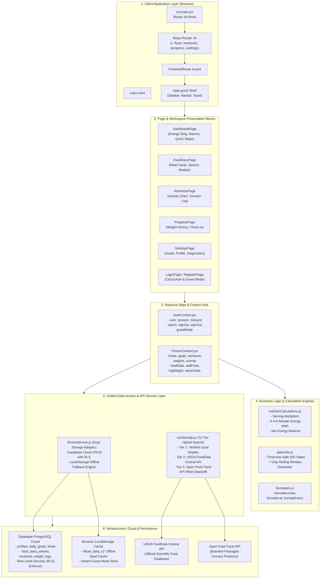

### Layer Interaction & Boundaries

1. **Presentation Layer (`src/pages`, `src/components`)**:
   - Zero direct database queries or raw `localStorage` calls.
   - All mutations and state reads occur exclusively via `useFitness()` and `useAuth()` React hooks.
   - UI re-renders reactively upon context state updates.
2. **State & Context Layer (`src/context`)**:
   - Holds the single source of truth for all synchronized user metrics.
   - Orchestrates optimistic UI updates (e.g. step count updates immediately while persisting in the background).
3. **Logic & Mathematical Layer (`src/utils`)**:
   - Pure, deterministic functions with zero side-effects.
   - 100% testable via unit tests without mocking the DOM or network.
4. **Service & Persistence Layer (`src/services`)**:
   - Decouples storage mechanics from the UI.
   - Automatically detects whether Supabase is configured and reachable; falls back cleanly to local browser storage so the user experience is never blocked.

---

## 3. End-to-End Operational Flowcharts

These sequence diagrams illustrate the operational lifecycles of key features across the system.

### Flow 1: Authentication & Session Lifecycle

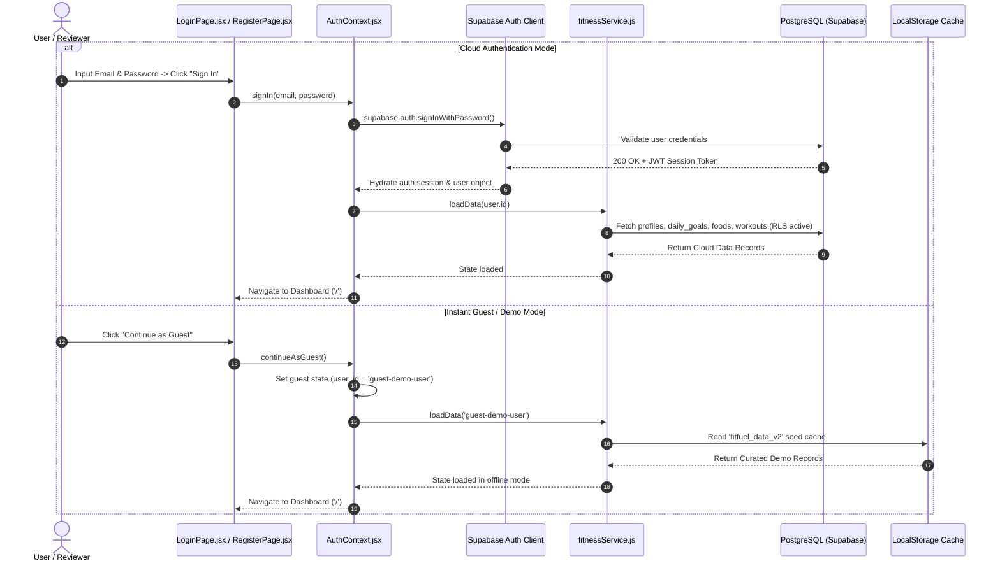

---

### Flow 2: Tri-Tier Hybrid Nutrition Search & Scaling

```mermaid
sequenceDiagram
    autonumber
    actor User as User
    participant Modal as FoodSearchModal.jsx
    participant Engine as nutritionApi.js
    participant Staples as Verified Staples
    participant USDA as USDA FoodData Central
    participant OFF as Open Food Facts
    participant Math as nutritionCalculations.js
    participant FitCtx as FitnessContext.jsx

    User->>Modal: Type search query (e.g., "Chicken Breast")
    Modal->>Engine: searchFoodDatabase("Chicken Breast", customFoods)

    par Tier 1: Local Curated Staples & Custom Foods
        Engine->>Staples: Filter local verified Indian & global foods
        Staples-->>Engine: Instant verified items
    and Tier 2: USDA Scientific Search
        Engine->>USDA: GET /foods/search?query=Chicken+Breast
        USDA-->>Engine: Scientific nutrient items
    end

    opt Tier 3: Supplementary Branded Search (< 4 results)
        Engine->>OFF: GET /cgi/search.pl (with exponential backoff)
        OFF-->>Engine: Commercial branded foods
    end

    Engine-->>Modal: Merged, deduplicated & normalized food array
    Modal-->>User: Render search results cards with source badges

    User->>Modal: Select food & adjust serving slider (e.g., 200g)
    Modal->>Math: calculateServingNutrition(food, 200, 'g')
    Math-->>Modal: Scaled calories, protein, carbs, fats
    Modal-->>User: Real-time updated macro preview

    User->>Modal: Click "Add to Diary"
    Modal->>FitCtx: addFood(scaledEntry)
    FitCtx-->>User: Show Toast ("Food added to diary!")
```

---

### Flow 3: Food Diary Logging & Reactive Macro Rollup

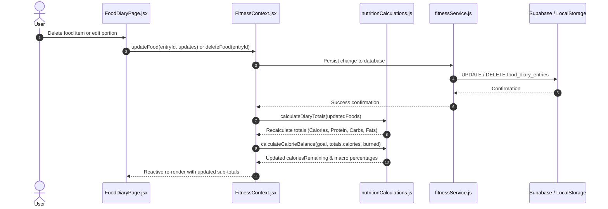

---

### Flow 4: Workout Logging & 7-Day Analytics Aggregation

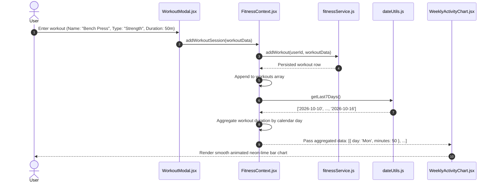

---

### Flow 5: Weight Tracking & Dynamic Progression Curve

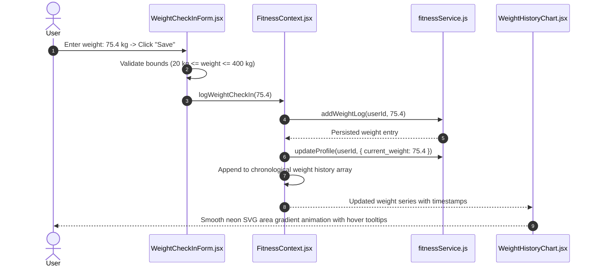

---

## 4. Granular Functional Specifications — Individual Architectural Blocks

Each functional block is designed to be self-contained, modular, and easy for any developer to understand, test, and enhance.

---

### Block 1: Authentication & Authorization Block

- **Location:** [`src/context/AuthContext.jsx`](file:///c:/final%20year%20proejct/fit-fuel-tracker/src/context/AuthContext.jsx), [`src/components/auth/ProtectedRoute.jsx`](file:///c:/final%20year%20proejct/fit-fuel-tracker/src/components/auth/ProtectedRoute.jsx), [`src/lib/supabase.js`](file:///c:/final%20year%20proejct/fit-fuel-tracker/src/lib/supabase.js), [`src/pages/LoginPage.jsx`](file:///c:/final%20year%20proejct/fit-fuel-tracker/src/pages/LoginPage.jsx), [`src/pages/RegisterPage.jsx`](file:///c:/final%20year%20proejct/fit-fuel-tracker/src/pages/RegisterPage.jsx).
- **Core Purpose:** Manages user authentication lifecycle, JWT token persistence, session restoration, access security, and 1-click guest evaluation mode.

#### Block Architecture Diagram:

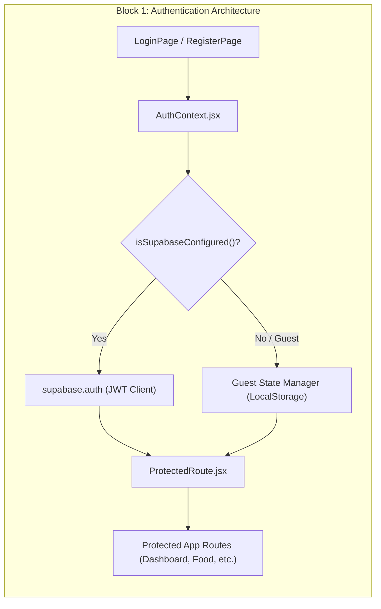

#### Exported APIs & Methods:

```javascript
import { useAuth } from '../context/AuthContext';
const { user, session, loading, isGuest, isConfigured, signIn, signUp, signOut, continueAsGuest } = useAuth();
```

| Method / Property | Signature | Input Types | Output Type | Description & Behavior |
|:---|:---|:---|:---|:---|
| `signIn` | `(email, password)` | `string, string` | `Promise<{ user, session }>` | Authenticates against Supabase Auth. Throws descriptive error on bad credentials. |
| `signUp` | `(email, password, fullName)` | `string, string, string` | `Promise<{ user, session }>` | Creates user in `auth.users`. Triggers database trigger `handle_new_user()` to provision profile. |
| `signOut` | `()` | *none* | `Promise<void>` | Clears JWT session, resets guest flags, and redirects to `/login`. |
| `continueAsGuest` | `()` | *none* | `void` | Instantly sets `isGuest = true`, assigning user ID `guest-demo-user`. Skips network authentication. |
| `isConfigured` | *boolean* | *none* | `boolean` | True if valid Supabase environment variables are present in the runtime. |
| `ProtectedRoute` | `<ProtectedRoute>{children}</ProtectedRoute>` | React Children | React Node | Redirects unauthenticated visitors to `/login` while preserving current URL state. |

#### Developer Extension Guide:
> **How to add OAuth (e.g. Google Sign-In):**  
> 1. In [`src/context/AuthContext.jsx`](file:///c:/final%20year%20proejct/fit-fuel-tracker/src/context/AuthContext.jsx), add:
> ```javascript
> const signInWithGoogle = () => supabase.auth.signInWithOAuth({ provider: 'google' });
> ```
> 2. Expose `signInWithGoogle` in the context value.
> 3. Add a Google button in [`src/pages/LoginPage.jsx`](file:///c:/final%20year%20proejct/fit-fuel-tracker/src/pages/LoginPage.jsx) calling `signInWithGoogle()`.

---

### Block 2: Reactive State Hub & Context Block

- **Location:** [`src/context/FitnessContext.jsx`](file:///c:/final%20year%20proejct/fit-fuel-tracker/src/context/FitnessContext.jsx).
- **Core Purpose:** Central state store for all active fitness and nutrition records. Coordinates between presentation views and the persistence adapter.

#### Block Architecture Diagram:

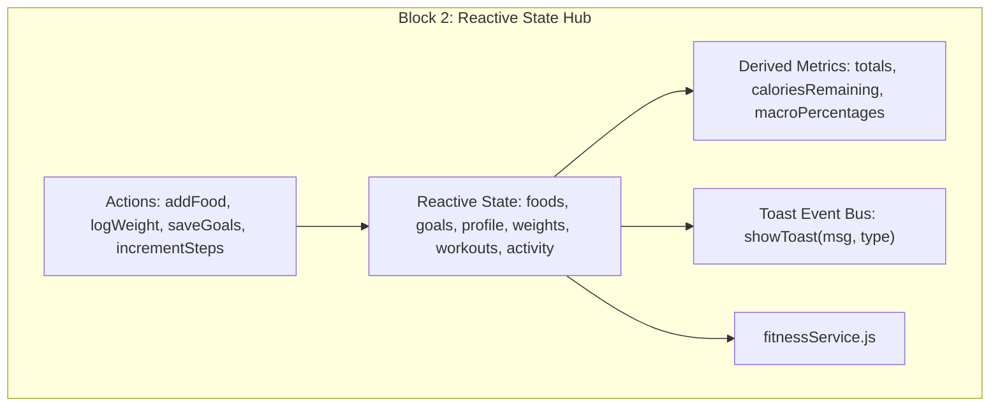

#### Exported APIs & State Properties:

```javascript
import { useFitness } from '../context/FitnessContext';
const fitness = useFitness();
```

| Property / Action | Type / Signature | Description |
|:---|:---|:---|
| `selectedDate` | `string (YYYY-MM-DD)` | Currently selected date in the food diary and activity view. |
| `profile` | `Object` | User profile data (`full_name`, `avatar_url`, `current_weight`, `goal_type`). |
| `goals` | `Object` | Daily targets (`calories`, `protein`, `carbs`, `fats`, `water_target`, `step_target`). |
| `foods` | `Array<FoodEntry>` | Food diary entries logged for the `selectedDate`. |
| `workouts` | `Array<Workout>` | Workout logs sorted chronologically. |
| `weights` | `Array<WeightLog>` | Weight check-in history array. |
| `activity` | `Object` | Daily activity for `selectedDate` (`steps`, `water_intake`, `calories_burned`). |
| `totals` | `Object` | Computed sum of calories, protein, carbs, fats, and fiber for the active date. |
| `caloriesRemaining`| `number` | Net calories remaining: `goals.calories - totals.calories + activity.calories_burned`. |
| `changeDate(isoDate)` | `(isoDate: string) => void` | Updates active date and re-queries diary entries for that date. |
| `addFood(entry)` | `(entry: FoodDiaryEntry) => Promise<FoodDiaryEntry>` | Saves food entry and updates diary state. |
| `updateFood(id, updates)` | `(id: string, updates: Object) => Promise<Object>` | Modifies an existing diary entry. |
| `deleteFood(id)` | `(id: string) => Promise<void>` | Deletes an entry and updates totals. |
| `logWeightCheckIn(weight)` | `(weight: number) => Promise<void>` | Records new weight check-in and updates current weight in profile. |
| `saveGoals(newGoals)` | `(newGoals: Object) => Promise<void>` | Persists updated daily targets and updates reactive meters. |
| `incrementSteps(count)` | `(count: number) => Promise<void>` | Optimistically increases step counter by `count` and persists. |
| `incrementWater(liters)` | `(liters: number) => Promise<void>` | Optimistically increases water intake by `liters` (e.g. 0.25L). |
| `showToast(msg, type)` | `(msg: string, type: 'success'\|'error'\|'info') => void` | Triggers a self-dismissing 2.4s banner toast. |

---

### Block 3: Unified Persistence & Storage Adapter Block

- **Location:** [`src/services/fitnessService.js`](file:///c:/final%20year%20proejct/fit-fuel-tracker/src/services/fitnessService.js).
- **Core Purpose:** Decoupled storage adapter that provides identical asynchronous CRUD methods whether communicating with Supabase PostgreSQL (via network) or browser `localStorage` (offline/guest mode).

#### Block Architecture Diagram:

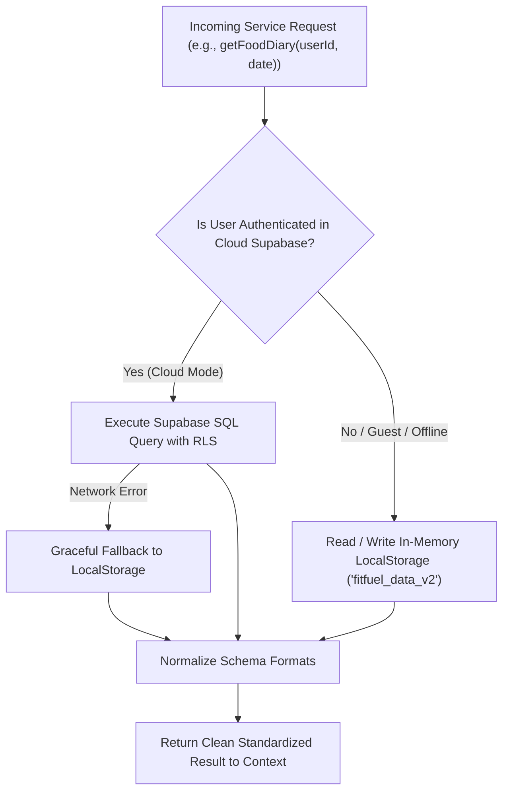

#### Core Methods & Signatures:

1. **Profile & Goals Subsystem:**
   - `getProfile(userId)`: Returns `{ id, full_name, avatar_url, current_weight, goal_type }`.
   - `updateProfile(userId, updates)`: Updates profile fields and persists.
   - `getDailyGoals(userId)`: Reads target goals; defaults to `2800 kcal, 160g P, 300g C, 85g F`.
   - `updateDailyGoals(userId, goals)`: Upserts daily target goals.
2. **Food Diary & Custom Foods Subsystem:**
   - `getFoodDiary(userId, date)`: Fetches entries for the specified ISO date.
   - `addFoodDiaryEntry(userId, entry)`: Inserts a scaled food entry into `food_diary_entries`.
   - `updateFoodDiaryEntry(userId, entryId, updates)`: Modifies portion size, meal type, or macros.
   - `deleteFoodDiaryEntry(userId, entryId)`: Permanently deletes entry.
   - `getCustomFoods(userId)`: Fetches user-authored custom foods.
   - `addCustomFood(userId, food)`: Stores a new custom food item in `foods` table (`is_custom = true`).
3. **Workouts & Activity Subsystem:**
   - `getWorkouts(userId, limit)`: Retrieves logged workouts.
   - `addWorkout(userId, workout)`: Inserts session (`name`, `type`, `duration`, `notes`).
   - `deleteWorkout(userId, workoutId)`: Deletes workout record.
   - `getDailyActivity(userId, date)`: Retrieves steps, water intake, and burned calories.
   - `updateDailyActivity(userId, date, updates)`: Upserts daily activity metrics.
4. **Weight Tracking Subsystem:**
   - `getWeightLogs(userId, limit)`: Fetches weigh-ins sorted chronologically by timestamp.
   - `addWeightLog(userId, weight, date)`: Inserts new weigh-in record.
5. **System Readiness Diagnostics:**
   - `checkDatabaseReadiness()`: Probes the Supabase connection and verifies table accessibility. Returns:
     ```typescript
     { ready: boolean, mode: 'cloud' | 'demo', message: string, tables: string[] }
     ```

---

### Block 4: Multi-Source Nutrition Search Engine Block

- **Location:** [`src/services/nutritionApi.js`](file:///c:/final%20year%20proejct/fit-fuel-tracker/src/services/nutritionApi.js).
- **Core Purpose:** Hybrid search engine querying across three distinct tiers of nutrition data to guarantee fast, resilient, and accurate food search under any network condition.

#### Block Architecture Diagram:

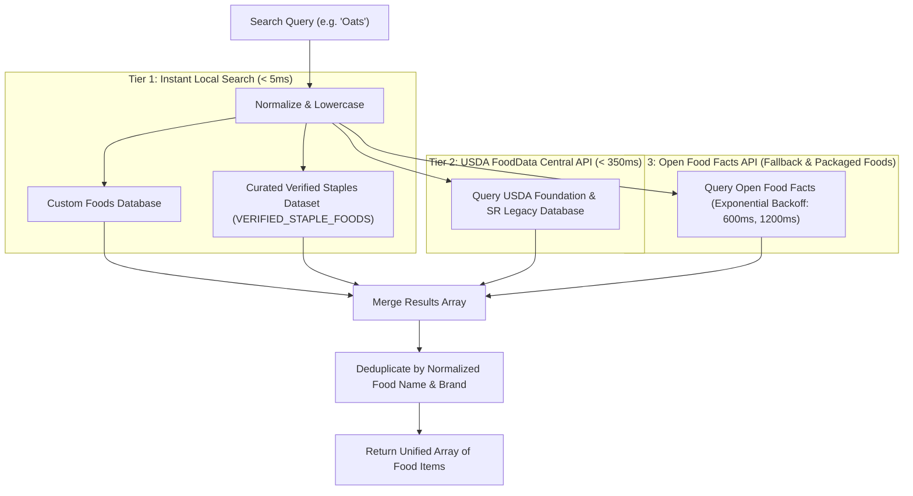

#### Exported Functions & Data Contracts:

```javascript
import { searchFoodDatabase, testNutritionApis, VERIFIED_STAPLE_FOODS } from '../services/nutritionApi';
```

- **`searchFoodDatabase(query, customFoods = [])`**:
  - *Inputs:* `query: string`, `customFoods: Array<Food>`
  - *Returns:* `Promise<Array<NormalizedFoodItem>>`
  - *Normalized Food Item Shape:*
    ```typescript
    interface NormalizedFoodItem {
      id: string;
      name: string;
      brand?: string;
      source: 'verified' | 'usda' | 'openfoodfacts' | 'custom';
      serving_size: number;      // e.g. 100
      serving_unit: string;      // 'g', 'ml', 'piece', 'serving'
      calories: number;          // kcal per base serving
      protein: number;           // grams per base serving
      carbs: number;             // grams per base serving
      fats: number;              // grams per base serving
      fiber?: number;            // grams per base serving
    }
    ```
- **`VERIFIED_STAPLE_FOODS`**: Offline dataset containing staple Indian and global bodybuilding nutrition (e.g. Chicken breast, Whole eggs, Egg whites, Paneer, Whey protein isolate, White rice, Rolled oats, Dal, Roti, Greek yogurt, Almonds, Peanut butter, Banana, Apple).
- **`testNutritionApis()`**: Diagnostic utility measuring live latency and status for external APIs.

---

### Block 5: Mathematical & Nutrition Calculation Engine Block

- **Location:** [`src/utils/nutritionCalculations.js`](file:///c:/final%20year%20proejct/fit-fuel-tracker/src/utils/nutritionCalculations.js).
- **Core Purpose:** Pure functional math engine responsible for nutrient scaling, macro energy conversions, percentage distributions, and diary aggregations.

#### Mathematical Formulas & Logic:

1. **Dynamic Serving Scaling:**
   $$\text{Multiplier} = \begin{cases} \text{Quantity} & \text{if unit is 'serving' or 'piece'} \\ \frac{\text{Quantity}}{\text{Base Serving}} & \text{if unit is 'g' or 'ml'} \end{cases}$$
   $$\text{Scaled Calories} = \max\left(0, \text{round}(\text{Base Calories} \times \text{Multiplier})\right)$$
   $$\text{Scaled Macro} = \max\left(0, \frac{\text{round}(\text{Base Macro} \times \text{Multiplier} \times 10)}{10}\right)$$

2. **Atwater 4-4-9 Macro Energy Distribution:**
   $$\text{Protein Energy} = \text{Protein (g)} \times 4\text{ kcal}$$
   $$\text{Carbs Energy} = \text{Carbs (g)} \times 4\text{ kcal}$$
   $$\text{Fats Energy} = \text{Fats (g)} \times 9\text{ kcal}$$
   $$\text{Total Caloric Energy} = \text{Protein Energy} + \text{Carbs Energy} + \text{Fats Energy}$$
   $$\text{Protein \%} = \text{round}\left(\frac{\text{Protein Energy}}{\text{Total Caloric Energy}} \times 100\right)$$

3. **Net Caloric Balance:**
   $$\text{Calories Remaining} = \text{Goal Calories} - \text{Consumed Calories} + \text{Burned Calories}$$

#### Exported Functions:
| Function | Signature | Description |
|:---|:---|:---|
| `calculateServingNutrition` | `(food, quantity, unit)` | Returns dynamically scaled calories and macros for any portion size. |
| `calculateMacroPercentages` | `(protein, carbs, fats)` | Returns `{ proteinPct, carbsPct, fatsPct }` based on Atwater energy ratios. |
| `calculateCalorieBalance` | `(goal, consumed, burned)` | Calculates net calories remaining. |
| `calculateDiaryTotals` | `(entries = [])` | Aggregates daily macros and segments items into Breakfast, Lunch, Dinner, and Snacks. |

---

### Block 6: Utility, Date & Formatting Engine Block

- **Location:** [`src/utils/dateUtils.js`](file:///c:/final%20year%20proejct/fit-fuel-tracker/src/utils/dateUtils.js), [`src/utils/formatters.js`](file:///c:/final%20year%20proejct/fit-fuel-tracker/src/utils/formatters.js), [`src/utils/schemaSql.js`](file:///c:/final%20year%20proejct/fit-fuel-tracker/src/utils/schemaSql.js).
- **Core Purpose:** Standardizes date manipulations (preventing UTC day-shift bugs), formats localized strings and currencies, and exports SQL migration blueprints.

#### Core Exported Functions:
- `toIsoDate(date = new Date())`: Formats a Date object to `YYYY-MM-DD` in the user's local timezone.
- `formatDisplayDate(isoString)`: Formats date for headers (e.g., `"Monday, Oct 16"`).
- `getRelativeDayName(isoString)`: Identifies `"Today"`, `"Yesterday"`, or formatted string.
- `getLast7Days()`: Generates chronological 7-day array of ISO strings for weekly charts.
- `formatNumber(value)`: Adds comma separators (`12,500`).
- `formatKcal(value)`: Formats calories with `kcal` unit suffix.
- `formatGrams(value)`: Formats grams with one decimal place and `g` suffix.
- `SQL_MIGRATION_SCRIPT`: Raw string export of full PostgreSQL schema rendered in Settings for 1-click clipboard copying.

---

### Block 7: Page & Workspace Presentation Blocks

- **Location:** [`src/pages/`](file:///c:/final%20year%20proejct/fit-fuel-tracker/src/pages/).
- **Core Purpose:** Routed page views coordinating feature-specific child components.

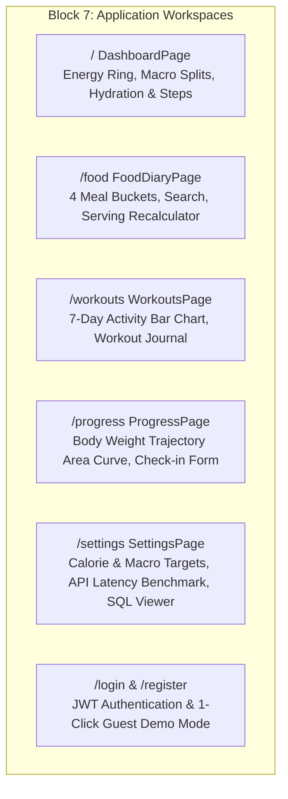

| Page Component | Route | Key Child Components | User Capabilities |
|:---|:---:|:---|:---|
| [`DashboardPage.jsx`](file:///c:/final%20year%20proejct/fit-fuel-tracker/src/pages/DashboardPage.jsx) | `/` | `HeroBanner`, `CalorieRing`, `MacroCards`, `ActivitySummary` | Daily overview, remaining calorie ring gauge, macro splits, 1-click step and water logging. |
| [`FoodDiaryPage.jsx`](file:///c:/final%20year%20proejct/fit-fuel-tracker/src/pages/FoodDiaryPage.jsx) | `/food` | Date Navigator, `MealCard` (x4), `FoodSearchModal`, `CustomFoodModal`, `EditFoodModal` | Categorized meal logging (Breakfast, Lunch, Dinner, Snacks), live search modal, custom food builder, item editing and deletion. |
| [`WorkoutsPage.jsx`](file:///c:/final%20year%20proejct/fit-fuel-tracker/src/pages/WorkoutsPage.jsx) | `/workouts` | `WeeklyActivityChart`, `SessionList`, `WorkoutModal` | Training journal, 7-day duration charts, logging workouts by type (Strength, Cardio, Sports, Mobility) with notes. |
| [`ProgressPage.jsx`](file:///c:/final%20year%20proejct/fit-fuel-tracker/src/pages/ProgressPage.jsx) | `/progress` | `WeightHistoryChart`, `WeightCheckInForm`, Stat Chips | Weight trend analysis, interactive Recharts weight progression curve, daily weigh-in check-in form. |
| [`SettingsPage.jsx`](file:///c:/final%20year%20proejct/fit-fuel-tracker/src/pages/SettingsPage.jsx) | `/settings` | `ProfileSettingsForm`, `GoalSettingsForm`, SQL Inspector, Diagnostic Panel | Updating profile, personalizing daily targets (calories, macros, water, steps), testing API latencies, and inspecting SQL migrations. |
| [`LoginPage.jsx`](file:///c:/final%20year%20proejct/fit-fuel-tracker/src/pages/LoginPage.jsx) | `/login` | Auth Form, Guest Button | User authentication portal with instant guest evaluation access. |
| [`RegisterPage.jsx`](file:///c:/final%20year%20proejct/fit-fuel-tracker/src/pages/RegisterPage.jsx) | `/register` | Registration Form, Password Validation | User sign-up creating Supabase auth credentials and provisioning default profile and goal rows. |
| [`NotFoundPage.jsx`](file:///c:/final%20year%20proejct/fit-fuel-tracker/src/pages/NotFoundPage.jsx) | `*` | 404 Hero, Redirect | Graceful catch-all 404 page directing users back to the dashboard. |

---

### Block 8: Visual Analytics & Reusable Component Blocks

- **Location:** [`src/components/`](file:///c:/final%20year%20proejct/fit-fuel-tracker/src/components/).
- **Core Purpose:** Encapsulated, reusable UI components implementing design tokens, glassmorphic styling, and interactive data visualizations.

#### 1. Visualization Analytics:
- [`CalorieRing.jsx`](file:///c:/final%20year%20proejct/fit-fuel-tracker/src/components/dashboard/CalorieRing.jsx): Concentric circular SVG gauge rendering consumed vs. target calories with dynamic neon-lime fill arcs and center label.
- [`WeeklyActivityChart.jsx`](file:///c:/final%20year%20proejct/fit-fuel-tracker/src/components/workouts/WeeklyActivityChart.jsx): Responsive Recharts bar chart displaying minutes trained per day over the previous 7 days with active hover tooltips.
- [`WeightHistoryChart.jsx`](file:///c:/final%20year%20proejct/fit-fuel-tracker/src/components/progress/WeightHistoryChart.jsx): Responsive Recharts smooth area curve displaying weigh-ins with custom neon-lime gradient fills.

#### 2. Modal & Dialog Blocks:
- [`Modal.jsx`](file:///c:/final%20year%20proejct/fit-fuel-tracker/src/components/common/Modal.jsx): Accessible portal dialog with backdrop blur, keyboard ESC dismissal, and focus trapping.
- [`FoodSearchModal.jsx`](file:///c:/final%20year%20proejct/fit-fuel-tracker/src/components/food/FoodSearchModal.jsx): Multi-source search dialog with live search input, debouncing, and dynamic serving quantity recalculation.
- [`CustomFoodModal.jsx`](file:///c:/final%20year%20proejct/fit-fuel-tracker/src/components/food/CustomFoodModal.jsx): Form dialog to create and save unlisted foods.
- [`EditFoodModal.jsx`](file:///c:/final%20year%20proejct/fit-fuel-tracker/src/components/food/EditFoodModal.jsx): Modal allowing adjustments to serving size or meal type for previously logged items.
- [`WorkoutModal.jsx`](file:///c:/final%20year%20proejct/fit-fuel-tracker/src/components/workouts/WorkoutModal.jsx): Form dialog to record workouts with type badges and notes.

#### 3. Common Shell Blocks:
- [`Sidebar.jsx`](file:///c:/final%20year%20proejct/fit-fuel-tracker/src/components/common/Sidebar.jsx): Desktop side navigation and mobile drawer with quick navigation links, branding, motivational card, and user profile badge.
- [`Navbar.jsx`](file:///c:/final%20year%20proejct/fit-fuel-tracker/src/components/common/Navbar.jsx): Top bar displaying dynamic page titles, localized date, mobile drawer toggle, and sign-out button.
- [`Toast.jsx`](file:///c:/final%20year%20proejct/fit-fuel-tracker/src/components/common/Toast.jsx): Non-blocking notification banner fixed at screen bottom displaying success, error, and info notices.

---

## 5. Database Architecture & Security Engine

FitFuel utilizes a relational schema hosted on **Supabase PostgreSQL** designed with strict foreign key constraints, cascading deletions, and Row Level Security (RLS) enforcement.

### Entity Relationship Diagram (ERD)

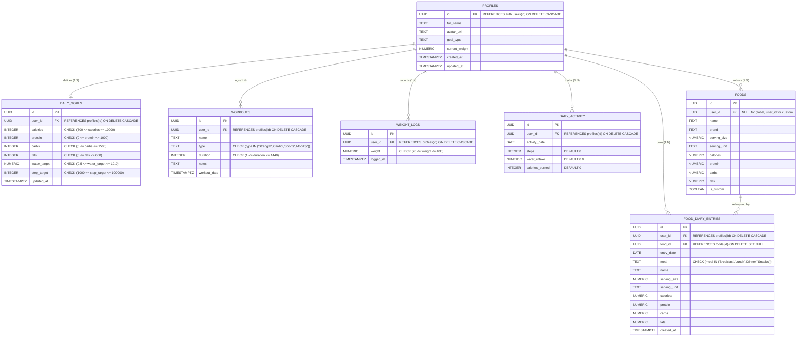

### Row Level Security (RLS) Policy Matrix

| Table | Policy Name | Permitted Roles | SQL Using / Check Condition |
|:---|:---|:---|:---|
| `profiles` | Users can view own profile | `authenticated` | `auth.uid() = id` |
| `profiles` | Users can update own profile | `authenticated` | `auth.uid() = id` |
| `daily_goals` | Users can view own goals | `authenticated` | `auth.uid() = user_id` |
| `daily_goals` | Users can update own goals | `authenticated` | `auth.uid() = user_id` |
| `foods` | Public read access for global foods | `anon, authenticated` | `user_id IS NULL OR auth.uid() = user_id` |
| `foods` | Users can insert custom foods | `authenticated` | `auth.uid() = user_id` |
| `food_diary_entries` | Users CRUD own diary | `authenticated` | `auth.uid() = user_id` |
| `workouts` | Users CRUD own workouts | `authenticated` | `auth.uid() = user_id` |
| `weight_logs` | Users CRUD own weights | `authenticated` | `auth.uid() = user_id` |
| `daily_activity` | Users CRUD own activity | `authenticated` | `auth.uid() = user_id` |

### Database Triggers & Automated Provisioning

1. **`handle_new_user()` Trigger:**
   - Executed automatically on `auth.users` row creation (sign-up).
   - Inserts a corresponding row in `public.profiles`.
   - Inserts default daily goals (`2800 kcal, 160g P, 300g C, 85g F, 3.0L water, 10000 steps`) into `public.daily_goals`.
2. **`update_updated_at_column()` Trigger:**
   - Automatically stamps UTC `now()` timestamps whenever rows in `profiles` or `daily_goals` are updated.

---

## 6. Quality Assurance & Automated Test Roadmap

The automated testing suite is powered by **Vitest** and guarantees mathematical accuracy, serving scaling, diary rollups, and storage fallbacks.

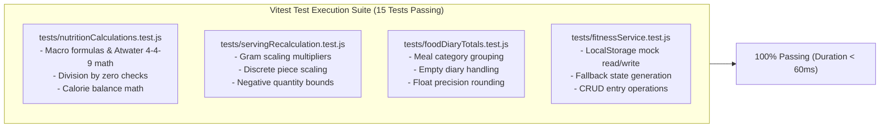

### Verification Matrix

```bash
# Execute the complete automated test suite
npm test
```

| Test File | Total Tests | Key Assertions Covered | Status |
|:---|:---:|:---|:---:|
| [`tests/nutritionCalculations.test.js`](file:///c:/final%20year%20proejct/fit-fuel-tracker/tests/nutritionCalculations.test.js) | 7 | Net balance formula, Atwater 4-4-9 macro %, division by zero protection, fiber aggregation | ✅ PASS |
| [`tests/servingRecalculation.test.js`](file:///c:/final%20year%20proejct/fit-fuel-tracker/tests/servingRecalculation.test.js) | 2 | Base 100g scaling to 150g/250g, unit servings (eggs/scoops) scaling | ✅ PASS |
| [`tests/foodDiaryTotals.test.js`](file:///c:/final%20year%20proejct/fit-fuel-tracker/tests/foodDiaryTotals.test.js) | 3 | Breakfast/Lunch/Dinner/Snacks rollups, empty days return zero totals | ✅ PASS |
| [`tests/fitnessService.test.js`](file:///c:/final%20year%20proejct/fit-fuel-tracker/tests/fitnessService.test.js) | 3 | LocalStorage fallback initialization, diary entry insertion, weight log appending | ✅ PASS |

---

## 7. Strategic Project Roadmap & Evolution Milestones

### Milestone Timeline

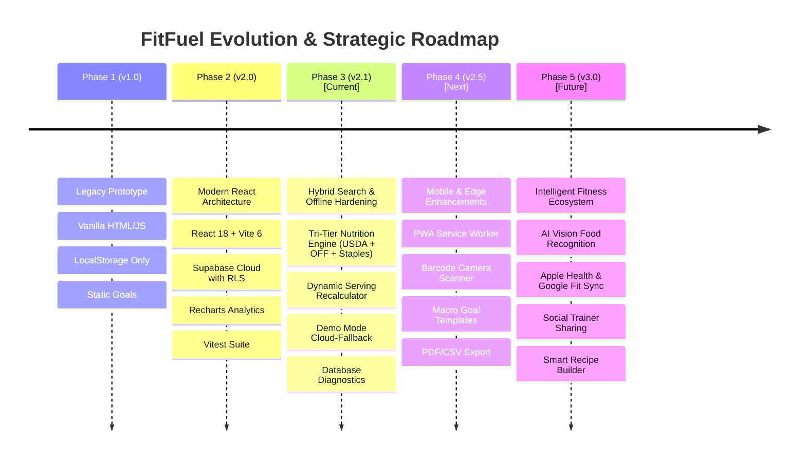

### Phased Breakdown

#### Phase 1: Prototype Foundation (v1.0) — *Completed*
- Single-page static web application (`index.legacy.html`, `app.legacy.js`, `styles.css`).
- Basic DOM manipulation with vanilla JavaScript.
- Browser `localStorage` storage for daily logs.
- Hardcoded daily goals (2800 kcal, 160g protein, 300g carbs, 85g fats).
- Manual input for meals without external nutrition APIs.

#### Phase 2: Modern Production Architecture (v2.0) — *Completed*
- Rebuilt from the ground up using **React 18** and **Vite 6**.
- Implemented **Tailwind CSS** with custom FitFuel dark theme tokens (`#0b0d12`, `#c8f169`).
- Introduced **Supabase PostgreSQL** cloud persistence with Row Level Security (RLS).
- Created **React Router v6** multi-page routing (`/`, `/food`, `/workouts`, `/progress`, `/settings`, `/login`, `/register`).
- Added declarative SVG analytics using **Recharts** (Energy Ring, Weekly Activity Bar Chart, Weight Trajectory Area Chart).
- Created automated test coverage with **Vitest** (15 unit tests covering nutrition math, scaling, diary rollups, and storage).

#### Phase 3: Hybrid Search & Resilience Hardening (v2.1) — *Current Release*
- **Tri-Tier Hybrid Nutrition Engine** ([`src/services/nutritionApi.js`](file:///c:/final%20year%20proejct/fit-fuel-tracker/src/services/nutritionApi.js)):
  - Local verified staples database (instant offline lookup).
  - Live query to USDA FoodData Central API.
  - Live query to Open Food Facts API with exponential retry backoff.
- **Dynamic Serving Recalculator** ([`src/utils/nutritionCalculations.js`](file:///c:/final%20year%20proejct/fit-fuel-tracker/src/utils/nutritionCalculations.js)):
  - Real-time proportional scaling of calories and macros when users modify grams, pieces, or serving units.
- **Dual-Engine Persistence Adapter** ([`src/services/fitnessService.js`](file:///c:/final%20year%20proejct/fit-fuel-tracker/src/services/fitnessService.js)):
  - Seamless automatic fallback to in-browser storage when Supabase is not configured or in Guest Mode.
- **Database Readiness & Diagnostics Inspector**:
  - Live status indicator in Settings checking database schema integrity and API response latencies.

#### Phase 4: Mobile & Edge Enhancements (v2.5) — *Planned Q4 2026*
- [ ] **Progressive Web App (PWA)**: Service Worker caching for complete offline operation and mobile "Add to Home Screen" support.
- [ ] **Barcode Scanning Engine**: Camera-based barcode scanner using HTML5 `BarcodeDetector` / ZXing library linked to Open Food Facts.
- [ ] **Macro Target Presets**: One-click goal templates (High-Protein Bulking, Lean Cutting, Ketogenic, Endurance, Maintenance).
- [ ] **Export & Reporting**: Generate downloadable weekly PDF health summaries and CSV spreadsheets for personal dietitians or coaches.
- [ ] **Water Reminders & Push Notifications**: Web notifications prompting hydration at custom user intervals.

#### Phase 5: Intelligent Fitness Ecosystem (v3.0) — *Planned 2027*
- [ ] **AI Meal Image Recognition**: Upload a photo of a meal to automatically detect food items and estimate portion weights and macros via Gemini Vision API.
- [ ] **Wearable Cloud Synchronization**: Bidirectional integration with Apple HealthKit, Google Fit, and Garmin Connect for automated step and active calorie syncing.
- [ ] **Social & Trainer Workspace**: Share daily logs with personal trainers, view peer leaderboards, and follow workout routines.
- [ ] **Smart Recipe Builder**: Calculate total and per-serving nutrition for custom home-cooked recipes with multi-ingredient breakdowns.

---

### Feature Completion Matrix

| Feature Module | Phase 1 (Legacy) | Phase 2 (Migration) | Phase 3 (Current) | Phase 4 (Next) | Phase 5 (Future) |
|:---|:---:|:---:|:---:|:---:|:---:|
| **Component Architecture** | ❌ (Monolithic) | ✅ (React 18) | ✅ (Optimized) | ✅ | ✅ |
| **Styling System** | Custom CSS | Tailwind CSS | Tailwind CSS | Tailwind CSS | Tailwind CSS |
| **Cloud Database** | ❌ | Supabase RLS | Supabase RLS | Supabase RLS | Multi-region |
| **Offline Guest Mode** | Basic | ❌ | ✅ (Dual-adapter) | ✅ (Full PWA) | ✅ |
| **Nutrition Search** | ❌ Manual only | Basic | ✅ Tri-tier Hybrid | Barcode Scan | AI Vision Scan |
| **Serving Scaling** | ❌ Fixed | Basic | ✅ Pure Dynamic | ✅ | Portions AI |
| **Data Visualization** | Basic HTML | Recharts | Recharts | Recharts + PDF | Advanced 3D |
| **Automated Testing** | ❌ 0 tests | 12 tests | ✅ 15 tests | 25+ tests | End-to-End |
| **Wearable Sync** | ❌ | ❌ | ❌ | ❌ | Apple/Google Fit |

---

## 8. Developer Modification & Extension Playbook

This playbook provides concrete recipes for any developer wishing to modify or extend the codebase.

### Recipe 1: Adding a New Meal Category
To add a new meal category (e.g. `"Pre-Workout"`):
1. **Database Schema:** In [`supabase/migrations/20261011_initial_schema.sql`](file:///c:/final%20year%20proejct/fit-fuel-tracker/supabase/migrations/20261011_initial_schema.sql), update the check constraint:
   ```sql
   ALTER TABLE food_diary_entries DROP CONSTRAINT food_diary_entries_meal_check;
   ALTER TABLE food_diary_entries ADD CONSTRAINT food_diary_entries_meal_check 
     CHECK (meal IN ('Breakfast', 'Lunch', 'Dinner', 'Snacks', 'Pre-Workout'));
   ```
2. **Diary Calculation Engine:** In [`src/utils/nutritionCalculations.js`](file:///c:/final%20year%20proejct/fit-fuel-tracker/src/utils/nutritionCalculations.js), add `'Pre-Workout'` to the default meal buckets in `calculateDiaryTotals`.
3. **UI Page:** In [`src/pages/FoodDiaryPage.jsx`](file:///c:/final%20year%20proejct/fit-fuel-tracker/src/pages/FoodDiaryPage.jsx), render another `<MealCard mealTitle="Pre-Workout" ... />`.

---

### Recipe 2: Adding a New Metric / Target to Settings
To add a new daily target (e.g. `"Fiber Target"`):
1. **Database Schema:** Add `fiber_target INTEGER DEFAULT 35` to `daily_goals` in SQL.
2. **Context Defaults:** In [`src/context/FitnessContext.jsx`](file:///c:/final%20year%20proejct/fit-fuel-tracker/src/context/FitnessContext.jsx), add `fiber_target: 35` to initial default goals state.
3. **Settings Form:** In [`src/components/settings/GoalSettingsForm.jsx`](file:///c:/final%20year%20proejct/fit-fuel-tracker/src/components/settings/GoalSettingsForm.jsx), add an input field bound to `goals.fiber_target`.

---

### Recipe 3: Integrating a New Nutrition API
To add another external data provider (e.g. Nutritionix or Edamam):
1. Open [`src/services/nutritionApi.js`](file:///c:/final%20year%20proejct/fit-fuel-tracker/src/services/nutritionApi.js).
2. Implement a dedicated search function returning the normalized structure:
   ```javascript
   async function searchNutritionix(query) {
     const res = await fetch(`https://trackapi.nutritionix.com/v2/search/instant?query=${encodeURIComponent(query)}`, { ... });
     const data = await res.json();
     return (data.common || []).map(item => ({
       id: `nix-${item.tag_id}`,
       name: item.food_name,
       source: 'nutritionix',
       serving_size: 100,
       serving_unit: 'g',
       calories: item.nf_calories,
       protein: item.nf_protein,
       carbs: item.nf_total_carbohydrate,
       fats: item.nf_total_fat,
     }));
   }
   ```
3. Add the function to the `Promise.allSettled` array inside `searchFoodDatabase()`.

---

### Recipe 4: Adding a New Chart / Visualization
To add a new weekly macro intake chart:
1. Create a component in `src/components/progress/MacroTrendChart.jsx` using `recharts` (`<ResponsiveContainer>`, `<BarChart>`, `<Bar>`).
2. Consume daily historical entries via `useFitness()`.
3. Import and render the chart in [`src/pages/ProgressPage.jsx`](file:///c:/final%20year%20proejct/fit-fuel-tracker/src/pages/ProgressPage.jsx).

---

## Summary & Verification Note

The FitFuel 2.0 architecture represents a production-grade fitness and nutrition platform. Every functional block is strictly decoupled, tested via Vitest unit tests, and equipped with automatic cloud-to-offline failover.

For further inquiries, contact Suryansh Tyagi (Utkarsh) or refer to the Architecture Decision Records in [`decision.md`](file:///c:/final%20year%20proejct/fit-fuel-tracker/decision.md).
